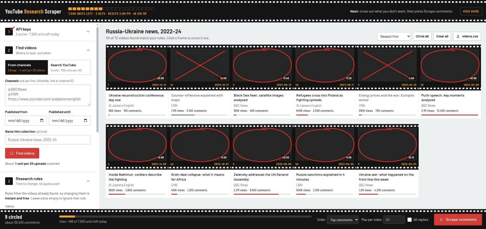
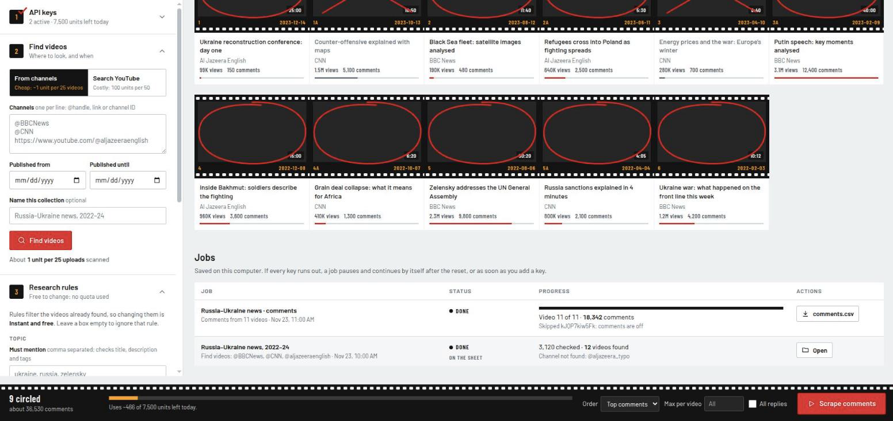
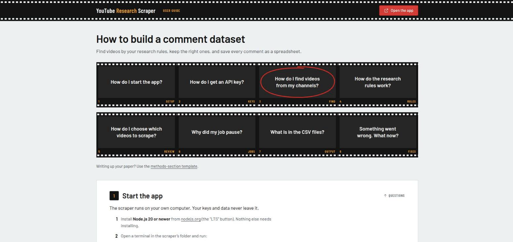
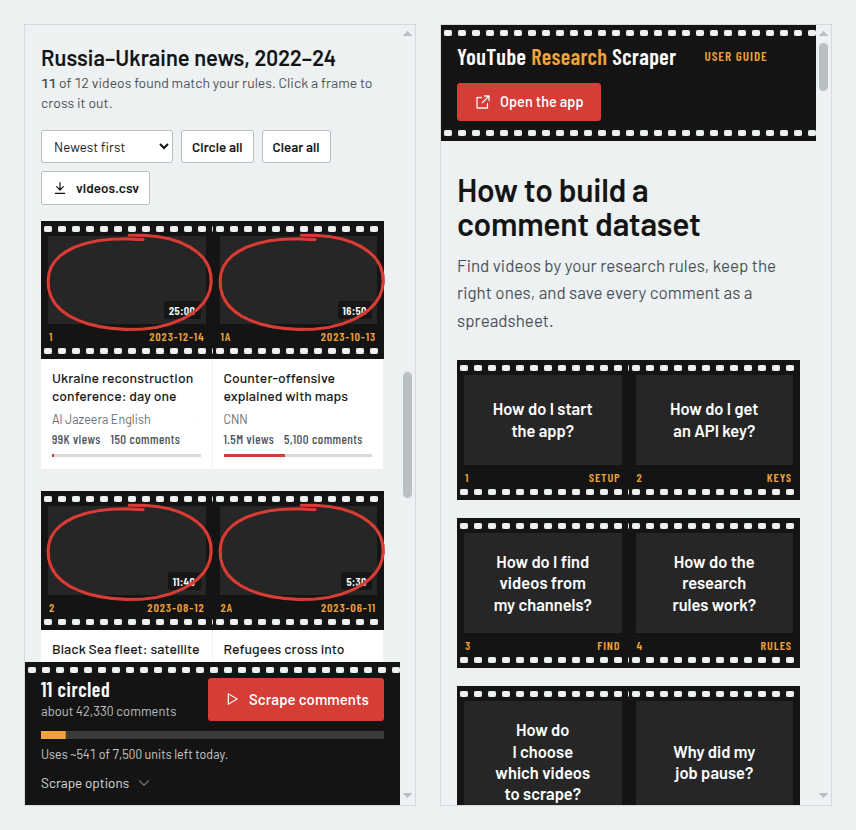

# YouTube Research Scraper

[](LICENSE)


Build YouTube comment datasets for research without hand-picking videos.

You describe the videos you want with rules: channels, date range, keywords, views, comment counts, language, no Shorts and so on. The tool finds the matching videos, lets you review them on a contact sheet, and scrapes all their comments to CSV. It shares the work across several API keys, so the daily quota is not a wall, and when every key runs out it pauses and resumes on its own.

It was built for the kind of dataset used in studies of public opinion on news videos, for example comments on Russia–Ukraine war coverage from BBC, CNN and Al Jazeera.



<sub>Screenshots use demo data. Video thumbnails are hidden.</sub>

## Screenshots

| Jobs and selection cost | User guide |
|---|---|
|  |  |

<p align="center"></p>

## Why

Existing comment scrapers start from videos you already have. The slow part of research is **finding the right videos** under clear, reportable rules. Doing that with YouTube's search API costs 100 quota units per call, so one key runs out after about 100 searches. This tool:

- **Finds videos cheaply.** It lists each channel's uploads at about 1 unit per 25 videos instead of searching.
- **Applies your rules locally.** Changing a rule costs no quota.
- **Pools API keys** from several Google Cloud projects and moves to the next key when one runs out.
- **Pauses instead of failing.** Progress is saved after every page, so a job survives quota limits, crashes and restarts.

## Features

- **Two ways to find videos:** from a list of channels (cheap), or by searching all of YouTube (costly; the cost is shown before you start).
- **Research rules:**
  - keywords to include (any or all) and to exclude, checked against title, description and tags
  - minimum and maximum views, likes, comments and length
  - comments per 1,000 views
  - language and category
  - skip Shorts, live streams, made-for-kids videos and videos with comments turned off
- **Many keywords and countries in one pool:** in search mode, one search per line and a list of countries; each video remembers which country and keyword found it.
- **Top N per group:** keep the most-commented (or most-viewed, most-liked) videos per year, country, year + country or channel, with a report of every group that fell short of the target.
- **Comment cleaning:** remove empty, emoji-only, link-only, bait and duplicate comments and comments with your own junk words; label each comment's script (Bengali, Arabic, English letters…); optionally translate non-English comments to English with the AI helper. Writes `comments-clean.csv` and `comments-removed.csv` (with the reason for each removal) and never changes your original `comments.csv`.
- **Optional AI helper** (free Gemini or OpenRouter key): describe your topic in plain words and it suggests keywords, and it can cross out off-topic videos by title. Only your topic text and video titles are sent, never comments or your YouTube keys.
- **Saved rule sets,** so the same selection can be repeated and reported in a methods section.
- **Contact-sheet review:** every match is a thumbnail circled in red; click one to cross it out.
- **Cost before you spend:** the selection strip shows the estimated quota cost against what's left today.
- **CSV output:** `videos.csv` and `comments.csv` (UTF-8 with BOM, so Excel shows Bangla, Russian and other scripts correctly). Replies are linked to their parent comment.
- **Built-in user guide** at `/guide`, written for non-developers.
- **Runs locally,** with zero npm dependencies. Your keys and data stay on your machine.

## Requirements

- [Node.js](https://nodejs.org) 20 or newer
- A free **YouTube Data API v3** key from Google Cloud (this is not an AI model key)

## Download the app

No Node.js needed. Get the file for your system from the [latest release](https://github.com/tanim913/yt-research-scraper/releases/latest). The app opens in your browser; keep its window open while you work, because closing it stops the app.

| System | File | How to install |
|---|---|---|
| Windows | `yt-research-scraper-setup-windows-x64.exe` | Run it and follow the steps, then start it from the Start menu. A `…-portable.exe` needs no install. |
| macOS (M1 or newer) | `yt-research-scraper-macos-apple-silicon.dmg` | Open it and drag the app into Applications. |
| macOS (Intel) | `yt-research-scraper-macos-intel.dmg` | Same as above. |
| Ubuntu / Debian | `yt-research-scraper-linux-amd64.deb` | `sudo apt install ./yt-research-scraper-linux-amd64.deb`, then start it from the applications menu or run `yt-research-scraper`. |
| Other Linux | `yt-research-scraper-linux-x64` | `chmod +x yt-research-scraper-linux-x64`, then run it. |

The apps are **not code-signed**, so the first launch shows a warning:

- **Windows:** "Windows protected your PC" → **More info** → **Run anyway**.
- **macOS:** right-click the app → **Open** → **Open**. On macOS 15 or newer, if that is not offered, open **System Settings → Privacy & Security**, scroll down and press **Open Anyway**.

The app keeps its data in `~/.yt-research-scraper/`. The apps are built by GitHub Actions ([release.yml](.github/workflows/release.yml)) when a version tag is pushed. The project page is built from [site/index.html](site/index.html) ([pages.yml](.github/workflows/pages.yml)).

## Set up the AI helper (optional, free)

The AI helper suggests keywords and search phrases, crosses out off-topic videos, and translates non-English comments. It needs a free key from **one** of these services. This is separate from your YouTube key.

**Google Gemini (recommended)**

1. Open [aistudio.google.com/apikey](https://aistudio.google.com/apikey) and sign in with a Google account.
2. Press **Create API key** and copy the key.
3. In the app, open step 3 **Research rules**, then **AI helper → Set up a free AI key**.
4. Choose **Google Gemini**, paste the key and press **Save AI key**. The line next to *Suggest keywords* shows "Ready" when it worked.

**OpenRouter**

1. Open [openrouter.ai/keys](https://openrouter.ai/keys), sign in, press **Create key** and copy it.
2. In the same box choose **OpenRouter**, paste the key, and keep a model whose name ends in `:free`. Free models are renamed from time to time; see [openrouter.ai/models](https://openrouter.ai/models?max_price=0) for the current ones.
3. Press **Save AI key**.

Then describe your topic in your own words and press **Suggest keywords**. After finding videos, press **AI: cross out off-topic** above the sheet. After scraping, **Clean comments → Translate with AI** adds an English column.

What is sent: your topic text, video titles and channel names, and (only when you press Translate) the comments you choose. Never your YouTube keys. Free plans have small limits, so big jobs take minutes, and free services may use submitted text to improve their products; read the service's terms before sending comments. The key is saved in `~/.yt-research-scraper/ai.json` on your computer.


### How the AI helper uses your free key

The AI only runs when you press one of three buttons. The app sends text in batches and waits 6 seconds between requests (at most 10 a minute), so a free plan is not used up in a burst.

| You press | What is sent | Requests | Example |
|---|---|---|---|
| **Suggest keywords** | Your topic sentence (up to 500 letters) and the keywords already in the box | 1 per press | One press is one request |
| **AI: cross out off-topic** | Video titles and channel names, 50 per request (titles cut at 140 letters); only videos still circled | 1 per 50 videos | 1,000 videos = 20 requests, about 2 minutes |
| **Translate with AI** | Text of comments not in English letters, 40 per request (cut at 500 letters) | 1 per 40 comments | 1,000 comments = 25 requests, about 3 minutes |

Token counts are rough: English is about 1 token per 4 letters, and Bangla and other scripts use noticeably more. If the service says you reached its free limit, the app stops with a message and keeps what it already did; translation continues where it left off.

**Never sent:** your YouTube API keys, comments you don't translate, view counts, likes, descriptions, or your downloaded files.

**Make your free tokens last:** apply the free keyword rules first so the AI checks fewer videos; run **Clean comments** before translating (it is free and drops spam and duplicates first); if you don't need English text, keep or remove non-English comments instead of translating; and check your key's limits on your Gemini or OpenRouter account page, because they change from time to time.

## Run from source

```bash
git clone https://github.com/tanim913/yt-research-scraper.git
cd yt-research-scraper
node server.js
```

Open <http://127.0.0.1:3000>. The user guide is at <http://127.0.0.1:3000/guide>.

To use another port, run `PORT=4000 node server.js`.

## Getting an API key

1. Go to [console.cloud.google.com](https://console.cloud.google.com/projectcreate) and create a project.
2. Open **APIs & Services → Library**, find **YouTube Data API v3**, and press **Enable**.
3. Open **Credentials → Create credentials → API key**, and copy the key.
4. Paste it into step 1 of the app.

Each key gives 10,000 units a day. **Keys only add up when they come from different projects;** keys in the same project share one quota. The quota resets at midnight Pacific time, and the app shows that moment in your local time.

## How to use it

1. **API keys:** add one or more keys.
2. **Find videos:** list channels (`@BBCNews`, a channel URL, or a `UC…` ID), set the date range, and press **Find videos**. Frames appear as videos arrive.
3. **Research rules:** narrow the results. The sheet updates as you type, and it costs nothing.
4. **Review:** cross out anything you don't want. Export `videos.csv` if you need the list.
5. **Scrape:** choose the comment order, a cap per video, and whether to fetch all replies, then press **Scrape comments**. Download `comments.csv` from **Jobs**, even while the job is running.

## Quota costs

| Action | Approximate cost |
|---|---|
| Find videos from channels | 1 unit per 25 videos scanned |
| Search all of YouTube | 100 units per 50 results |
| Scrape comments | 1 unit per 80–100 comments |
| Change research rules | free |

For example, about 86,000 comments from three news channels over two and a half years is roughly 1,000–1,500 units, which fits in one key's daily quota.

## Output

**comments.csv:** `video_id, video_title, channel, comment_id, parent_id, is_reply, author, text, like_count, published_at, reply_count`

**videos.csv:** `video_id, url, title, channel, published_at, views, likes, comments, duration_s, language, tags, search_regions, search_queries`

**comments-clean.csv:** the same columns as `comments.csv` plus `script` and `text_en` (the English text: your translation, or the original for English-letter comments). **comments-removed.csv** has `script` and `reason` instead.

```python
import pandas as pd
df = pd.read_csv("comments.csv")
top_level = df[df.is_reply == 0]
```

## Project structure

| File | Purpose |
|---|---|
| `server.js` | Local HTTP server and JSON API (bound to 127.0.0.1) |
| `yt.js` | YouTube API client: key pool, quota tracking, retries |
| `clean.js` | Comment cleaning: script labels, junk removal, translation merge |
| `ai.js` | Optional AI helper: keyword suggestions and off-topic check (Gemini or OpenRouter) |
| `jobs.js` | Discover and scrape jobs that save after every page and resume |
| `filters.js` | Research rules, applied locally |
| `index.html` | The app (single page, no build step) |
| `guide.html` | The user guide |
| `build.js` | Packs the app into a single executable (used by the release workflow) |
| `packaging/` | Builds the `.deb`, the Windows installer and the macOS `.dmg` |
| `test.js` | Tests against a fake API: no network, no quota |

Run the tests with:

```bash
node --test
```

## Privacy and security

- The server only listens on `127.0.0.1`, and it rejects requests that don't come from localhost.
- API keys, quota counters, jobs and CSVs are stored in `data/`, which is git-ignored. **Don't share that folder.**
- Only the official YouTube Data API v3 is used. There is no scraping of YouTube pages.

## Limits

- YouTube lists at most about the latest 20,000 uploads of a channel. For older videos on very large channels, use search mode with a date range.
- A search returns at most about 500 results.
- The language rule only removes videos whose uploader set a different language. Videos with no language set are kept.
- View and comment counts are recorded when the videos are found.
- Comment text is saved exactly as written. In Excel, a comment starting with `=`, `+`, `-` or `@` may be read as a formula; use pandas or Google Sheets import for analysis.

## License

[MIT](LICENSE)
